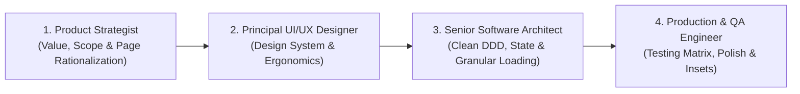
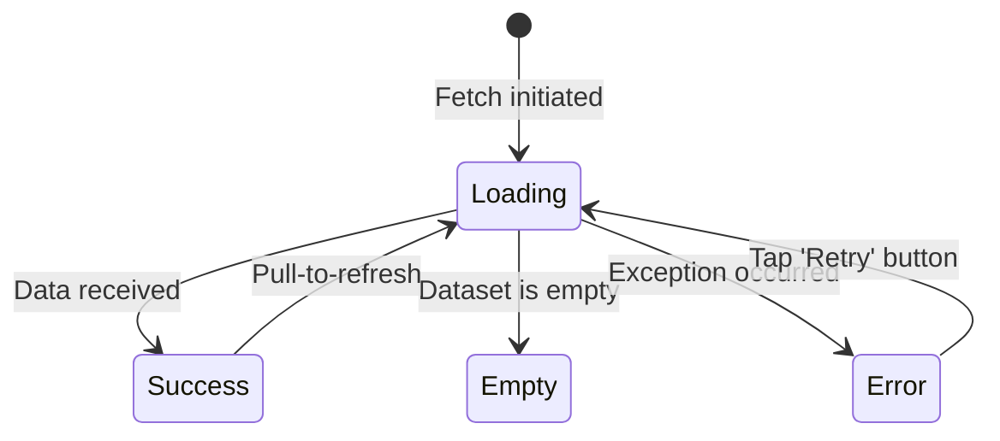
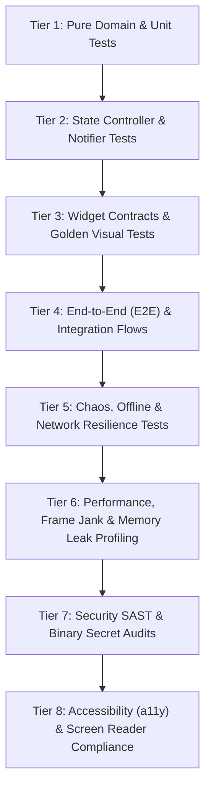

# 📱 Universal Senior Mobile Application Engineering & Product Doctrine

This doctrine establishes the **Complete Senior Lifecycle Framework** for conceiving, architecting, testing, and delivering world-class mobile applications. It empowers developers and AI agents to operate not merely as code generators, but as **Senior Product Engineers and Principal Mobile Architects** capable of tailoring standards intelligently to the specific scope, risk profile, and maturity of any project.

---

## Developer-Owned Device Session

- The user owns the Android Studio/Xcode run/debug session and physical-device visual review. By default, edit source and run appropriate local formatting, static analysis, and isolated automated tests; leave the running app and its debugger connection alone.
- A connected phone, a screenshot from it, or a request to fix UI does NOT authorize installing, launching, stopping, restarting, attaching to, or replacing the application. Do not run `flutter run`, `flutter install`, `flutter attach`, device install/launch/force-stop commands, or reset app data without an explicit user request covering that action.
- Preserve the user's hot-reload workflow. Let the user perform hot reload and report the visual result. Do not trigger hot reload/restart yourself unless requested. If a native or startup change requires hot restart or rebuild, explain why and let the user perform it; do not launch a second session to validate it.
- Report code/test results separately from user-confirmed visual results. Never claim physical-device rendering was verified merely because compilation or widget tests passed.

---

## 🎯 Modular Architecture & Project Profiling Matrix

Before writing code, the AI/engineer must identify the **Project Profile** to adapt requirements conditionally:

| Project Profile | Internationalization (i18n) | Architecture Depth | Testing Matrix Tier | Backend / Security | Observability & Release |
| :--- | :--- | :--- | :--- | :--- | :--- |
| 🌐 **Enterprise / FinTech / High-Scale** | Strict Multi-language Parity (`AppLocalizations` FR/EN) | Full DDD Feature-First (Domain, Data, Presentation, UseCases) | Tiers 1 to 8 (Unit, State, Goldens, E2E, Chaos, a11y, Security) | Remote APIs, Zero-Trust secrets, compile-time `--dart-define` | Crashlytics/Sentry, Fastlane CI/CD, Feature Flags |
| ⚡ **Focused MVP / Product Launch** | Monolingual Centralized Strings (`AppStrings` / i18n ready) | Pragmatic Feature-First (Entities + Repositories + Notifiers) | Tiers 1, 2, 3 (Unit, State, Widget Contracts) | Targeted Backend / Firebase / Supabase | Structured `AppLogger`, basic error boundaries |
| 💾 **Local-First / Standalone Tool** | Single/Multi-language based on target audience | Domain-First with Local Storage DataSources (Isar, Hive, SQLite) | Tiers 1, 2, 5 (Unit, State, Offline/Sync & DB migrations) | Local encryption, zero remote secrets | Local structured logging, database backup |

---

## 🎭 The 4-Hat Mindset of the Senior Mobile Engineer

Before writing a single line of code, the engineer and AI must cycle through 4 distinct personas:



1. **Product Strategist**: Profile project scope, challenge the need for every screen, eliminate friction, and streamline the core value loop.
2. **Principal UI/UX Designer**: Build cohesive design tokens, enforce thumb-friendly ergonomics, and reject amateur visuals.
3. **Senior Software Architect**: Enforce pure domain models, reactive state, typed failures, granular loading states, and conditional architecture depth.
4. **Production & QA Engineer**: Execute the comprehensive multi-tier testing matrix, ensure zero overflow, homothetic scaling, OS edge-to-edge transparency, and lifecycle resilience.

---

## 1. 🧭 Phase 1: Product Strategy & Page Rationalization

### 🔴 Anti-Patterns (Junior / Sub-standard)
- Creating a separate full-page screen for every tiny interaction or confirmation.
- Adding complex multi-step forms where a single focused sheet would suffice.
- Forcing users through bloated onboarding flows before demonstrating immediate core value.
- Cluttering the main navigation with 6+ bottom bar tabs.

### 🟢 Senior Architectural Doctrine

#### The "Page Justification" Filter:
For every screen requested or planned, ask:
1. **Core Purpose**: What single primary action or decision does the user make on this screen?
2. **Modal vs. Screen**: Can this be an interactive Bottom Sheet, an inline expandable card, or a confirmation snackbar rather than a heavy full route?
3. **Data Efficiency**: Does this screen require network roundtrips that could be prefetched or cached?
4. **Navigation Depth**: Keep critical user journeys under 3 taps from the home dashboard.

#### Core Navigation Architecture:
- **Bottom Navigation**: 3 to 5 tabs maximum (e.g., *Home/Explore, Search/Activity, Main Value Loop, Messages/Notifications, Profile/Settings*).
- **Secondary Flows**: Presented via adaptive Bottom Sheets (`showModalBottomSheet` with `isScrollControlled: true`) or dedicated nested routes.
- **Contextual Actions**: Place high-frequency actions within the primary thumb reach zone (bottom 40% of the viewport).

---

## 2. 🎨 Phase 2: World-Class UI/UX Design System & Visual Integrity

### 🔴 Anti-Patterns (Junior / Sub-standard)
- ❌ **Using Emojis in the UI**: Putting Unicode emojis in buttons, titles, badges, or headers.
- ❌ **Fake AI & Marketing Badges**: Slapping "99% AI Match" or fake compatibility meters not backed by real backend models.
- ❌ **Badge Overload**: Adding 4-5 repetitive tag chips to every list card, cluttering visual hierarchy.
- ❌ **Flat & Lifeless Surfaces**: Using flat, harsh monochrome backgrounds without subtle depth or contrast.
- ❌ **Tiny Touch Targets**: Buttons and icon buttons smaller than 44x44 dp.

### 🟢 Senior Architectural Doctrine

1. **Strict Zero-Emoji Policy**:
   - Use exclusively professional vector iconography (`LucideIcons`, `MaterialSymbols`, or custom SVGs).
   - Emojis cheapen institutional apps and render inconsistently across Android and iOS vendors.

2. **Visual Depth & Semantic Palette**:
   - Utilize refined gradients and surface layers for headers and action cards:
     - `headerGradientStart` -> `headerGradientEnd`
     - `surfaceLight` vs `surfaceDark` with subtle borders (`1px` with `0.08` opacity).
   - Maintain high contrast ratios (>= 4.5:1) for accessibility compliance (WCAG AA).

3. **Sobriety & Hierarchy**:
   - Max 1-2 contextual badges per card (e.g., *Status*, *Category*).
   - Clear typographical rhythm based on an 8pt grid system (8, 16, 24, 32 dp).

4. **Thumb-Zone Mobile Ergonomics**:
   - Primary Call to Action (CTA) must always be sticky at the bottom or reachable with one hand.
   - Minimum interactive touch target: 48x48 dp.

---

## 3. 🌍 Phase 3: Adaptive Internationalization (i18n) & Centralized Text Architecture

### 🔴 Anti-Patterns
- Hardcoding raw user-facing strings (`Text("Connexion")` or `Text("Submit")`) directly in widgets.
- Forcing full bilingual translation overhead on single-language local MVPs when not requested.
- Neglecting text expansion: designing fixed-width containers that break when translated to longer languages (French text is typically 20–30% longer than English).

### 🟢 Senior Architectural Doctrine (Conditional Implementation)

#### 🔀 Condition A: Multi-Language / International Project (e.g., French + English Parity)
- **Mandatory Dual-Dictionary**: Every string presented to the user (titles, labels, buttons, tooltips, validation errors, dialogs, empty states) MUST be registered in the localization dictionary (`AppLocalizations`).
- **Strict Parity**: Every key must have natural, verified translations in **both French (`fr`) and English (`en`)**.
- **Access Pattern**:
  ```dart
  Text(AppLocalizations.of(context).loginButtonLabel)
  ```

#### 🔀 Condition B: Single-Language Project / Local MVP (e.g., 100% French or 100% English)
- **Centralized Text Architecture**: Zero raw strings scattered in widget trees. All strings are organized in a dedicated semantic constants class (`AppStrings` or single-locale `AppLocalizations`).
- **Zero Translation Overhead**: Do NOT invent or force a secondary language file if the product specifications do not require it.
- **Future-Ready Contract**:
  ```dart
  // Clean centralized access
  Text(AppStrings.loginButtonLabel)
  ```

#### 📐 Universal Text Resilience (Applies to ALL Projects):
- Never set rigid fixed `width` on containers holding user text.
- Always protect text with `Wrap`, `Flexible`, `Expanded`, or `FittedBox(fit: BoxFit.scaleDown)` with `maxLines` and `TextOverflow.ellipsis`.

---

## 4. 📐 Phase 4: Homothetic Responsive Engine & Zero-Overflow Doctrine

### 🔴 Anti-Patterns
- Using hardcoded pixel dimensions (`width: 350`, `height: 80`) that break on small phones (SE 320-375dp) or stretch awkwardly on tablets.
- Unhandled system accessibility text zoom breaking UI buttons and header text.
- Yellow/Black `RenderFlex overflowed by X pixels` stripes when the on-screen keyboard appears.
- Header titles truncated with ellipsis (`...`) on compact devices due to fixed layout widths.

### 🟢 Senior Architectural Doctrine

1. **System Text-Scaling Bounds**:
   - Clamp the OS accessibility text scaler at the root widget to prevent destructive layout blowups:
   ```dart
   MaterialApp(
     builder: (context, child) {
       final mediaQuery = MediaQuery.of(context);
       return MediaQuery(
         data: mediaQuery.copyWith(
           textScaler: mediaQuery.textScaler.clamp(minScaleFactor: 0.85, maxScaleFactor: 1.15),
         ),
         child: child!,
       );
     },
   );
   ```

2. **Screen Ratio Engine (Homothetic Proportional Scaling)**:
   - Provide centralized, high-precision extensions calibrated on the reference canvas (`kRefScreenWidth = 390.0` or `448.0`, `kRefScreenHeight = 844.0` or `998.0`):
   ```dart
   extension ResponsiveExtensions on BuildContext {
     Size get screenSize => MediaQuery.sizeOf(this);
     double get screenWidth => screenSize.width;
     double get screenHeight => screenSize.height;

     bool get isMobile => screenWidth < 768;
     bool get isTablet => screenWidth >= 768 && screenWidth < 1024;
     bool get isDesktop => screenWidth >= 1024;

     // Ratio factors with broad adaptive bounds (0.68x - 1.15x) for compact devices
     double get widthRatio => isMobile ? (screenWidth / kRefScreenWidth).clamp(0.68, 1.15) : 1.0;
     double get heightRatio => isMobile ? (screenHeight / kRefScreenHeight).clamp(0.68, 1.15) : 1.0;

     /// Proportional width
     double rW(double size) => (size * widthRatio).roundToDouble();

     /// Proportional height
     double rH(double size) => (size * heightRatio).roundToDouble();

     /// Proportional square element (avatars, icons, action buttons, bell triggers)
     double rSize(double size) => (size * widthRatio).roundToDouble();

     /// Proportional fluid typography
     double rSp(double fontSize) => (fontSize * widthRatio).roundToDouble();

     /// Proportional padding and spacing
     double rPad(double space) => (space * widthRatio).roundToDouble();
   }
   ```

3. **Dynamic Title & Header Protection (`FittedBox`)**:
   - Wrap dynamic header titles, username greetings, and metrics in `FittedBox(fit: BoxFit.scaleDown)` with `maxLines: 1` to ensure zero truncated ellipses (`...`) on compact phones.

4. **Protected Universal Primitives (`AppButton`)**:
   - Buttons must encapsulate loading spinners, disabled states, and text protection:
   ```dart
   class AppButton extends StatelessWidget {
     final String text;
     final VoidCallback? onPressed;
     final bool isLoading;
     final bool isDisabled;
     
     const AppButton({
       super.key,
       required this.text,
       required this.onPressed,
       this.isLoading = false,
       this.isDisabled = false,
     });

     @override
     Widget build(BuildContext context) {
       final effectiveDisabled = isDisabled || isLoading || onPressed == null;
       return SizedBox(
         height: context.rW(52),
         width: double.infinity,
         child: ElevatedButton(
           onPressed: effectiveDisabled ? null : onPressed,
           child: isLoading
               ? SizedBox(
                   width: context.rW(22),
                   height: context.rW(22),
                   child: const CircularProgressIndicator(strokeWidth: 2.2),
                 )
               : FittedBox(
                   fit: BoxFit.scaleDown,
                   child: Text(text, maxLines: 1),
                 ),
         ),
       );
     }
   }
   ```

5. **Keyboard Avoidance & Scroll Hygiene**:
   - Interactive forms and input screens must always be wrapped in:
   ```dart
   SingleChildScrollView(
     keyboardDismissBehavior: ScrollViewKeyboardDismissBehavior.onDrag,
     padding: EdgeInsets.only(
       left: context.rPad(16),
       right: context.rPad(16),
       bottom: MediaQuery.viewInsetsOf(context).bottom + context.rPad(24),
     ),
     child: ...
   )
   ```

6. **Large Screen & Tablet Constraints**:
   - Cap maximum content width to `600dp` centered on tablet viewports:
   ```dart
   Center(
     child: ConstrainedBox(
       constraints: const BoxConstraints(maxWidth: 600),
       child: child,
     ),
   )
   ```

---

## 5. 🔘 Phase 5: Granular Button & Action Loading Isolation

### 🔴 Anti-Patterns (Amateur / "Violent" UI Loading)
- ❌ **Monolithic `isLoading` Flag**: Using a single global boolean `isLoading` on a screen containing multiple action buttons (e.g. "Continue with Google", "Continue with Apple", "Sign In with Email", or "Save Draft" vs "Publish").
- ❌ **Mass Button Spinning**: When the user taps one button, *every* button on the screen abruptly turns into a spinner simultaneously. This looks chaotic, amateurish, and confuses the user about which process is running.

### 🟢 Senior Architectural Doctrine (Conditional & Adaptive)

#### 🔀 Multi-Action Screens (Auth, Workflows, Wizard):
1. **Scoped Action Identifiers / Enums**:
   - Model asynchronous actions as typed enums or distinct identifiers:
   ```dart
   enum AuthAction { none, google, apple, emailPassword }

   class AuthState {
     final AuthAction loadingAction;
     final String? errorMessage;
     
     bool get isAnyLoading => loadingAction != AuthAction.none;
     bool isLoading(AuthAction action) => loadingAction == action;
   }
   ```

2. **Targeted Loader vs. Graceful Disabling**:
   - **Only the triggered button shows the spinner**: `isLoading: state.isLoading(AuthAction.google)`.
   - **Sibling buttons are safely disabled WITHOUT showing spinners**: `isDisabled: state.isAnyLoading`.
   ```dart
   // Google Button
   AppButton(
     text: strings.continueWithGoogle,
     isLoading: state.isLoading(AuthAction.google),
     isDisabled: state.isAnyLoading,
     onPressed: () => ref.read(authNotifierProvider.notifier).signInWithGoogle(),
   ),
   const SizedBox(height: 12),
   // Apple Button
   AppButton(
     text: strings.continueWithApple,
     isLoading: state.isLoading(AuthAction.apple),
     isDisabled: state.isAnyLoading,
     onPressed: () => ref.read(authNotifierProvider.notifier).signInWithApple(),
   ),
   ```

#### 🔀 Interactive Lists & Collections:
- In lists with row-level action triggers (e.g., "Follow", "Apply", "Delete", "Bookmark"), track loading state per item ID (`final Set<String> loadingItemIds;`).
- Only the row matching the tapped ID displays a spinner; the rest of the list remains clear and stable.

#### 🔀 Single-Action Dedicated Screens:
- On screens with a single isolated primary action (e.g., "Confirm SMS Code"), a simple boolean `isLoading` is fully acceptable and optimal.

---

## 6. 🏛️ Phase 6: Clean Architecture Doctrine (Feature-First, Technology-Agnostic)

Clean Architecture exists for ONE reason: **business rules must not know which framework, database, cloud or SDK is used.** Tomorrow the backend can move from Firebase to Supabase, REST, GraphQL or a local DB — only the outermost adapters and the composition root may change.

### 6.1 The Dependency Rule (absolute)

```
presentation ──► domain ◄── data
        ▲                     ▲
        └── app (composition root / DI) ──┘
```

- `domain` depends on **nothing** (pure Dart; `package:meta` / `package:collection` allowed).
- `data` depends on `domain` (implements its contracts) and on SDKs.
- `presentation` depends on `domain` only. It NEVER imports `data/` nor any backend SDK.
- `app/` (composition root) is the ONLY place that knows which concrete implementation fulfills which contract.
- A feature never imports another feature's `data/` or `presentation/` internals. Cross-feature needs go through the other feature's `domain` contracts (or the shared kernel in `core/`).

### 6.2 Technology-Agnostic Naming (zero vendor names)

Names describe the **role**, never the **technology**. A vendor name in a file, class, folder, method or field is an architecture leak.

| ❌ Leaky (forbidden) | ✅ Role-based |
| :--- | :--- |
| `firebase_auth_service.dart`, `FirebaseAuthService` | `auth_remote_data_source.dart`, `AuthRemoteDataSource` |
| `supabase_post_service.dart` | `listing_remote_data_source.dart` |
| `listing_model.dart` + `ListingModel.fromFirestore()` | `listing_dto.dart` + `ListingDto.fromMap()` |
| `hive_favorites.dart`, `SharedPrefsFavorites` | `favorites_local_data_source.dart` |
| `oci_image_storage.dart`, `S3Uploader` | `media_remote_data_source.dart` |
| `dio_client.dart` | `api_client.dart` |
| `DocumentSnapshot? lastDoc` in a controller | `ListingCursor? cursor` (domain value object) |
| `Timestamp createdAt` in an entity | `DateTime createdAt` |

Rules:
- SDK types (`DocumentSnapshot`, `Timestamp`, an auth SDK `User`, `XFile`, `PostgrestException`, `DioException`…) **never cross** the data layer boundary. They are converted inside the data source / DTO.
- Pagination cursors, ids, errors and streams exposed by repositories are domain types.
- The vendor name appears **only** in `import` lines of data-source implementation files and in the composition root.
- Product concepts are not technology: `signInWithGoogle()` is fine (Google is an identity *provider* the user sees); `firebaseSignIn()` is not.

### 6.3 Canonical Feature Layout

```
lib/
├── main.dart                         # bootstrap() only
└── src/
    ├── app/                          # composition root
    │   ├── bootstrap.dart            # SDK init, error handlers, ProviderScope
    │   ├── app.dart                  # MaterialApp.router
    │   ├── di/                       # binds contracts → implementations (ONLY place)
    │   └── router/                   # routes, guards, shell (bottom nav)
    ├── core/                         # shared kernel, feature-agnostic
    │   ├── error/                    # Failure (sealed), Result<T>, DataException
    │   ├── logging/                  # AppLogger
    │   ├── l10n/                     # AppStrings
    │   ├── theme/                    # tokens: colors, typography, spacing, radii, shadows
    │   ├── responsive/               # context.rW / rH / rSp
    │   ├── formatting/               # price/date formatters (presentation-side)
    │   └── widgets/                  # AppButton, AppNetworkImage, Shimmer, StateViews
    └── features/<feature>/
        ├── domain/
        │   ├── entities/             # immutable, pure, enums for closed sets
        │   ├── value_objects/        # ListingCursor, PhoneNumber, ...
        │   ├── repositories/         # abstract contracts: <Name>Repository
        │   └── usecases/             # ONLY when orchestration/business rules exist
        ├── data/
        │   ├── dtos/                 # <Name>Dto: fromMap/toMap + toEntity/fromEntity
        │   ├── datasources/          # <Name>RemoteDataSource / <Name>LocalDataSource (abstract)
        │   │                         # + <Name>RemoteDataSourceImpl (the ONLY SDK-aware code)
        │   └── repositories/         # <Name>RepositoryImpl: calls sources, maps errors → Failure
        └── presentation/
            ├── controllers/          # Notifiers + immutable UI state
            ├── screens/              # route-level widgets (pure renderers)
            └── widgets/              # feature-specific components
```

### 6.4 File & Symbol Naming Conventions

- Files `snake_case`, one public type per file, file name = type name (`listing_repository.dart` → `ListingRepository`).
- Suffixes by role: `Repository`, `RepositoryImpl`, `RemoteDataSource`, `LocalDataSource`, `Dto`, use case = verb phrase (`PublishListing`), `Controller` (state holder), `State`, `Screen`, `Sheet`, `Dialog`, `Tile`, `Card`.
- Entities carry no suffix (`Listing`, not `ListingEntity` / `ListingModel`).
- No dumping grounds: `utils.dart`, `helpers.dart`, `constants.dart`, `common/`, `misc/` are forbidden. Name by purpose (`price_formatter.dart`, `phone_number.dart`).
- Booleans read as questions (`isRented`, `hasMore`); methods are verbs (`fetchPage`, `publish`, `markAsRented`).

### 6.5 Errors Across Layers

```
SDK exception ─(data source)─► DataException (neutral) ─(repository)─► Failure (sealed) ─(controller)─► UI text via AppStrings
```

- Data sources translate SDK errors into neutral `DataException`s (`network`, `permissionDenied`, `notFound`, `unauthenticated`, `unknown`).
- Repositories return `Result<T>`; they never throw.
- Controllers expose state; widgets map `Failure` → text. `e.toString()` never reaches the user.

### 6.6 Dependency Injection & State

- **Contract providers throw by default** and are bound in the composition root, so presentation never imports `data/`:
  ```dart
  // features/listings/presentation/providers/listings_dependencies.dart
  final listingRepositoryProvider = Provider<ListingRepository>(
    (ref) => throw UnimplementedError('Bound in app/di'),
  );

  // app/di/dependency_overrides.dart — the ONLY file importing *Impl classes
  List<Override> dependencyOverrides() => [
    listingRepositoryProvider.overrideWith(
      (ref) => ListingRepositoryImpl(ListingRemoteDataSourceImpl(store)),
    ),
  ];

  // bootstrap.dart
  runApp(ProviderScope(overrides: dependencyOverrides(), child: const App()));
  ```
- **Feature public port**: when other features need a feature (session, media upload), expose ONLY its contracts in `features/<f>/<f>_providers.dart` (e.g. `auth_providers.dart` with `authRepositoryProvider`, `currentUserProvider`). Other features import that file and `<f>/domain`, never `<f>/data` or `<f>/presentation`.
- **Cross-feature screens** are reached by route (`context.push<bool>(AppRoutes.signIn)`), never by importing the other feature's widget. The router (in `app/`) composes screens.
- **Device capabilities** (dialer, WhatsApp, share sheet, photo picker, camera) sit behind `core/` contracts (`ContactLauncher`, `PhotoPicker`) with `*Impl` bound in `app/di`, so widgets stay testable.
- Tests override the contract providers with fakes — no SDK in tests above the data layer.
- One controller per screen concern. UI state is immutable with `copyWith`; nullable fields use `T? Function()?` parameters in `copyWith` so they can be cleared.
- **Stale responses**: controllers that reload on user input (search, filters) keep a generation counter and drop responses of older requests; always check `ref.mounted` after an `await`.

### 6.7 Use Cases — Pragmatism

- **Create a use case** when it orchestrates several repositories/services or enforces a business rule (e.g. `PublishListing`: validate → compress → upload media → write listing → rollback media on failure).
- **Do not create** pass-through use cases (`GetListings` that only calls `repository.fetch()`). Controllers may call repositories directly.

### 6.8 Domain Purity Checklist (review gate)

- [ ] No `package:flutter`, no SDK, no `dart:io` in `domain/`.
- [ ] No formatting (currency, dates), colors, icons or localized strings in entities.
- [ ] Closed sets are enums with an explicit, stable wire `key` mapped in DTOs (never persist `enum.name` blindly).
- [ ] Invariants enforced by factories / value objects where relevant.
- [ ] `grep -riE "firebase|firestore|supabase|hive|oci|dio" lib/src/**/domain lib/src/**/presentation` returns nothing.

### 🔒 Zero-Trust Security (When Connecting to Remote Services)
- **Never store sensitive secrets in the app binary**: admin keys, service-role keys, cloud storage credentials live only on servers / edge functions.
- **Never commit `.env` files with secrets** — not even "test" ones. If it happened, rotate the key immediately (git history is forever).
- Inject public, publishable variables at compile time:
  `flutter build apk --dart-define=MEDIA_API_URL=https://media.domain.com`

---

## 7. 🛡️ Phase 7: Exhaustive 4-State UI Contract & Error Architecture

### 🔀 Asynchronous / Data-Driven Views:
Every screen that fetches data from an async source (Remote API, DB query, File I/O) MUST implement the **Canonical 4-State Contract**:



1. **Loading**: Content-shaped **Skeleton/Shimmer** loader matching the exact shape of the incoming content (never a solitary raw center spinner).
2. **Success / Data**: The rendered view with native **Pull-to-Refresh** (`RefreshIndicator`).
3. **Empty**: Contextual vector illustration + clear localized explanation + primary **Call to Action** button.
4. **Error**: Clear human-friendly explanation + prominent **"Réessayer / Retry"** action button.

### 🔀 Synchronous / Pure Form Screens:
- Do not invent artificial `Loading` or `Empty` states for instantaneous local views. Ensure instant rendering, responsive validation messages on fields, and clear snackbar/toast feedback on completion.

---

## 8. 🧪 Phase 8: Comprehensive 8-Tier Mobile Testing Matrix (World-Class Standards)

Senior mobile engineers and high-growth tech companies verify applications across an exhaustive **8-Tier Testing Matrix**. Apply each tier conditionally based on the project's risk and maturity profile:



### 📋 Tier Breakdown & Execution Protocols:

#### 1. 🔬 Tier 1: Pure Domain & Unit Tests (Mandatory for ALL Projects)
- **Scope**: Entities, Value Objects, Business validation rules, DTO serialization/deserialization, Formatter utilities.
- **Rules**: Zero Flutter dependencies, executes in milliseconds, 100% deterministic (no real network or disk).
- **Example**:
  ```dart
  test('UserEntity calculates completion score accurately', () {
    final user = UserEntity(hasAvatar: true, hasResume: true, skillsCount: 4);
    expect(user.profileCompletionPercentage, 85);
  });
  ```

#### 2. ⚡ Tier 2: State Controller & Notifier Tests (Mandatory for ALL Projects)
- **Scope**: State transitions in Riverpod `AsyncNotifier`, Bloc `Cubit`, or ViewModel.
- **Verification**:
  - Initial → Loading → Success (with payload).
  - Initial → Loading → Failure (`AppFailure` mapped).
  - **Granular Loading Isolation**: Verify only the specific `loadingAction` changes during multi-button flows.
- **Tools**: `mocktail`, `flutter_test`.

#### 3. 🖼️ Tier 3: Widget Contracts & Golden Visual Tests
- **Scope**: Testing UI components across the 4 canonical states (*Loading Shimmer, Data, Empty, Error*).
- **Responsive Multi-Screen Simulation**: Testing widgets under simulated viewports:
  - Compact (320x568 - iPhone SE)
  - Standard (390x844 - iPhone 14/15)
  - Large (448x998 - Pixel 8 Pro / Pro Max)
- **Text-Scaling Tolerance**: Test widget under `textScaler: 1.4x` to guarantee zero `RenderFlex overflow`.
- **Golden Tests (Enterprise/Scale)**: Pixel-perfect snapshot regression tests verifying Light/Dark mode appearance.

#### 4. 🔄 Tier 4: End-to-End (E2E) & Critical Flow Tests
- **Scope**: Automated navigation through entire business user journeys (e.g., *Onboarding → Sign In → Search Job → Submit Application → Confirmation*).
- **Route & Guard Verification**: Verify unauthenticated users hitting `/profile` are redirected to `/login`, and deep links `/jobs/:id` navigate to the correct detail view.
- **Tools**: `integration_test`, `Patrol`, or `Maestro`.
- *Condition*: Required for Enterprise / Production apps; optional for early MVPs.

#### 5. 🔌 Tier 5: Chaos, Offline & Network Resilience Tests
- **Scope**: How the app survives real-world mobile conditions:
  - **Network Timeout & Slow 3G**: Ensuring timeouts throw user-friendly `NetworkFailure` with retry triggers.
  - **HTTP 401 Unauthorized**: Ensuring expired tokens trigger automatic silent refresh or clean logout.
  - **HTTP 500 Server Errors**: Ensuring graceful error states without crashing.
  - **Offline-First Mode**: Verifying cached data displays immediately when disconnected from internet.

#### 6. 🏎️ Tier 6: Performance, Frame Jank & Memory Leak Profiling
- **Target**: Continuous 60fps / 120fps scrolling with zero frame drops (render time < 16 ms per frame).
- **Resource Disposal Verification**: Automated test verifying all `StreamSubscription`, `TextEditingController`, `AnimationController`, and `Timer` instances are cancelled when navigating away.
- **Binary Size Budget**: Monitoring APK/AAB and IPA binary size to prevent asset bloat.

#### 7. 🔒 Tier 7: Security SAST & Binary Secret Audits
- **Scope**:
  - Scanning compiled binaries to ensure **zero private API keys, master passwords, or tokens** are embedded in plaintext.
  - Verifying sensitive data stored locally uses encrypted containers (`FlutterSecureStorage` with Android KeyStore / iOS Keychain).
  - Verifying SSL Pinning and Certificate Transparency for FinTech/Banking apps.

#### 8. ♿ Tier 8: Accessibility (a11y) & Screen Reader Compliance
- **Scope**:
  - Verify every interactive button has a clear semantic label for TalkBack / VoiceOver.
  - Minimum touch target verification (≥ 48×48 dp).
  - Contrast ratio verification (≥ 4.5:1 for normal text, ≥ 3.0:1 for large headings).

---

## 9. 🔄 Phase 9: App Lifecycle, Background Sync & Observability

Enterprise-grade mobile apps handle OS interruptions gracefully:

1. **App Lifecycle Management (`WidgetsBindingObserver`)**:
   - **`AppLifecycleState.resumed`**: Refresh stale auth tokens, check for critical remote config updates, resume paused UI timers.
   - **`AppLifecycleState.paused` / `inactive`**: Pause resource-heavy streams, camera controllers, and sensor polling to preserve battery.

2. **Network Reconnection Synchronization**:
   - Monitor connection state (`connectivity_plus`). Automatically re-sync pending offline actions (e.g. queued form submissions) when internet returns.

3. **Structured Diagnostics & Crash Telemetry**:
   - Strictly prohibit raw `print()` statements.
   - Centralized `AppLogger` (`d`, `i`, `w`, `e`) integrated with Sentry or Firebase Crashlytics:
     - Automatically attach non-sensitive breadcrumbs (user navigation path) to crash reports.
     - **Strict Privacy Rule**: Never send PII, passwords, or credit card numbers to external logging servers.

4. **CI/CD Automated Release Gates (Fastlane / GitHub Actions)**:
   - Automated pipeline triggering on pull requests:
     1. `flutter analyze` (Zero warnings/lint errors).
     2. `flutter test` (Unit, State, Widget contracts).
     3. Automated build of release AAB/IPA with `--dart-define` compilation.

---

## 10. 🚀 Phase 10: OS-Native Polish, Routing & Production Deployment

1. **True Edge-to-Edge System Bars**:
   - Treat the status bar and bottom system navigation/gesture area as part of the screen design from day 0: no unintended gray/black strips, contrast scrims, dividers, or mismatched backgrounds.
   - In Flutter, enable `SystemUiMode.edgeToEdge` at startup and define a shared `SystemUiOverlayStyle` derived from the actual background/theme. Use transparent status/navigation/divider colors and appropriate status/navigation icon brightness; account for iOS `statusBarBrightness` too.
   - Apply the shared style through a root `AnnotatedRegion<SystemUiOverlayStyle>` around the routed child, including routes WITHOUT an AppBar. Reuse it in `AppBarTheme.systemOverlayStyle`; a startup call or AppBar-only configuration is insufficient. Allow route-level overrides for photos or contrasting headers.
   - On supported Android versions, explicitly set `systemStatusBarContrastEnforced: false` and `systemNavigationBarContrastEnforced: false` when the app provides readable contrast, avoiding OS-added scrims. Respect Android API/target-SDK limitations and vendor behavior; do not promise identical results everywhere.
   - Paint the intended background behind both system areas, preserve safe-area insets for controls, and keep floating navigation clear of the gesture indicator. Check light/dark themes, screens with/without AppBars, sheets, gesture/three-button navigation, and keyboard transitions as relevant. Automated widget tests cannot prove native system-bar rendering; physical-device visual confirmation belongs to the user unless explicitly delegated.

2. **Native OS Splash Screen Protocol**:
   - Splash screens belong to the native OS window manager (`flutter_native_splash` configuring Android 12+ Splash API and iOS `LaunchScreen.storyboard`).
   - Zero artificial `Future.delayed(Duration(seconds: 3))` timers in Flutter code.

3. **Declarative Routing & Deep Linking**:
   - Centralized declarative router (`GoRouter`) with authentication guards (`redirect` callback) and parameterized deep link routes (`/items/:id`).

---

## 11. 📦 Phase 11: Dependency Hygiene, Error Contracts & Delivery Discipline

### 1. Dependency Management (Non-Negotiable)
- **Never hand-edit version constraints in `pubspec.yaml`.** Use exclusively:
  - `flutter pub add <pkg>` / `flutter pub add dev:<pkg>`
  - `flutter pub remove <pkg>`
  - `flutter pub upgrade --major-versions` (deliberate, reviewed)
- Run `flutter pub outdated` at the start of every milestone; never pin a package to an old major "to make it compile" without a written reason.
- One responsibility = one package. Ban overlapping libraries (e.g. `hive` + `get_storage` + `sqflite` + `shared_preferences` for the same need).
- Before coding against a package, check its CURRENT major API (changelog) — never assume an older API from memory (e.g. `google_sign_in` 7.x, Riverpod 3.x, go_router).

### 2. Domain Purity — Extended
- Entities contain **no presentation logic**: no price formatting, no `Color`, no `IconData`, no localized strings. Formatting belongs to `presentation/` (extensions or presenters).
- Domain must not import `package:flutter/*` (not even `foundation.dart` for `@immutable` — use `package:meta` or freezed).
- Enums for closed sets (`ListingType`, `ListingStatus`), never raw strings travelling through the app.

### 3. Typed Error Contract
- Repositories NEVER throw to the UI. They return a sealed `Result<T>` (`Success` / `Err(Failure)`).
- `Failure` is a sealed hierarchy (`NetworkFailure`, `PermissionFailure`, `NotFoundFailure`, `ValidationFailure`, `UnknownFailure`) mapped once in the data layer from SDK exceptions.
- UI maps `Failure` → human message through `AppStrings`, never `e.toString()`.

### 4. Remote Lists & Data Cost
- Every remote list is **cursor-paginated** (page size 20) with infinite scroll + pull-to-refresh.
- Grid/list views load **thumbnails**, detail views load full images.
- Firestore: every compound query has its index declared in `firestore.indexes.json`; security rules validate field types/ownership and are versioned in the repo.

### 5. Media Pipeline (User-Generated Images)
- **Client-side compression is mandatory** before any upload (WebP, ~1080px short side q≈78 for full, ~420px q≈70 for thumbnail, EXIF/GPS stripped). Store width/height for aspect ratios.
- **Zero cloud credentials in the binary.** Pick the upload channel by what the storage can enforce:
  - **Signed URLs** (S3 presigned POST with `content-length-range`, GCS signed policy) only when the provider can cap size and content type in the signature.
  - **Validated proxied upload** otherwise (e.g. OCI PARs cannot limit size or type): a small API verifies the ID token, checks the real type from **magic bytes** (never the header), caps the size, rate-limits per user, and writes under a per-user prefix (`listings/{uid}/{listingId}/…`) so ownership is enforced by path.
- Per-file upload progress, and **rollback** (delete uploaded files) on ANY later failure — including a partial upload.
- A server-side job deletes orphaned media and expires stale items; immutable object names + `Cache-Control: public, max-age=31536000, immutable`.
- Android: use the system **Photo Picker** (`image_picker`), never request `READ_MEDIA_*` / storage permissions (Play policy).

### 6. Marketplace / UGC Hygiene
- Every user-published item has: owner id, status lifecycle (`active → rented/sold → expired → removed`), `expiresAt` with renewal, and a **Report** action.
- Browsing never requires an account; authentication is requested only at the moment of a write action (publish, report).

### 7. Legacy Migration Protocol
- Never refactor a legacy codebase in place file-by-file. **Build the new structure alongside** (`lib/src/`), switch the entry point once the first vertical slice works, then **delete the legacy code in one dedicated commit**.
- Legacy screens are used as functional reference only — no copy-paste of legacy state management.

### 8. Design Reference Gate
- Before building any new screen, collect 2–3 references (Dribbble, Pinterest, Mobbin) and validate the direction with the product owner. Then translate them into the existing design tokens — never introduce ad-hoc colors or font sizes in a screen.

### 9. Commit & Quality Discipline
- Conventional Commits (`feat(scope):`, `fix:`, `refactor:`, `chore(deps):`, `test:`), **one commit per coherent brick**.
- Gate before every commit: `dart format .` → `flutter analyze` (0 issues) → `flutter test` (green).
- Generated code (`*.g.dart`, `*.freezed.dart`) is regenerated with `dart run build_runner build -d`, never edited by hand.
- **Code generation is optional**: if the latest generator conflicts with the SDK's `analyzer`, prefer hand-written immutable classes (`@immutable`, `==`, `copyWith`) over pinning prerelease generators.
- No `print`/`debugPrint` in committed code — use `AppLogger`.
- Never add AI attribution trailers (`Co-Authored-By`) unless the owner asks for them.

### 10. Known Pitfalls (verified on Flutter 3.44 / Riverpod 3 / go_router 18)
- Riverpod 3: `Override` is exported from `package:flutter_riverpod/misc.dart`; family notifiers receive their argument in the constructor; failing providers **auto-retry by default** — pass `retry: (_, _) => null` when the error is a domain `Failure` the UI must show.
- `(f1, f2).wait` throws `ParallelWaitError`, hiding the typed exception: the repository `guard()` must unwrap it (or use `Future.wait`).
- `google_fonts` fetches at runtime: add `test/flutter_test_config.dart` setting `GoogleFonts.config.allowRuntimeFetching = false`; before release, bundle the font files in assets.
- **Android Core Library Desugaring & MultiDex**: Packages relying on modern Java APIs or notifications (`flutter_local_notifications`, Firebase) fail Android builds at `checkDebugAarMetadata` unless desugaring is enabled. Always configure `compileOptions { isCoreLibraryDesugaringEnabled = true }`, add `multiDexEnabled = true` in `defaultConfig`, and declare `coreLibraryDesugaring("com.android.tools:desugar_jdk_libs:2.1.4")` under `dependencies` in `android/app/build.gradle.kts`.
- Tests that read a `Notifier` whose `build()` schedules work must read the provider **before** awaiting.
- Firestore: an inequality filter forces ordering by that field first — design cursors that carry every ordered field (`price`, `createdAt`, `id`); expired items need a server job (or a client-side visibility filter), not an extra range filter.

---

## 🤖 Step-by-Step AI Execution Protocol

When prompted to create or evolve a mobile feature, the AI MUST follow this exact sequence:

1. **Step 1 (Project Profiling & Product Scope)**:
   - Identify project mode: Enterprise/Bilingual vs MVP/Monolingual vs Local-First.
   - Challenge screen count. Propose the minimal, most intuitive flow.
2. **Step 2 (Design System & Centralized Text)**:
   - Determine text strategy (`AppLocalizations` FR/EN or `AppStrings`).
   - Confirm typography tokens, non-flat surface gradients, and vector iconography.
3. **Step 3 (Domain & Contracts)**:
   - Write pure Dart entities and abstract repository contracts.
4. **Step 4 (Data, State & Granular Loading)**:
   - Implement data sources, DTOs, and reactive state notifiers with typed failures and isolated action loading identifiers (`loadingAction`).
5. **Step 5 (Presentation with UI Contracts & Homothetic Responsiveness)**:
   - Build UI using `AppButton`, `context.rW()`, `context.rH()`, `context.rSize()`, `context.rSp()`, `FittedBox` title safety, keyboard scroll hygiene, and shimmer loading.
6. **Step 6 (Testing & QA Execution)**:
   - Write Unit tests (Domain & DTOs), State Notifier tests, and Widget contract tests (testing 320dp, 390dp, 448dp + 1.4x text scaling).
7. **Step 7 (OS Polish & Verification)**:
   - Verify Edge-to-Edge compliance, zero hardcoded strings, zero emojis, zero shared loading flashes, lifecycle cleanup, and run automated test suite.
8. **Step 8 (Commit Gate)**:
   - `dart format .`, `flutter analyze` (0 issues), `flutter test` green, then one Conventional Commit per coherent brick (Phase 11).
