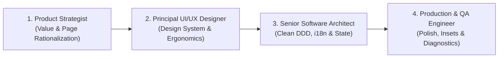
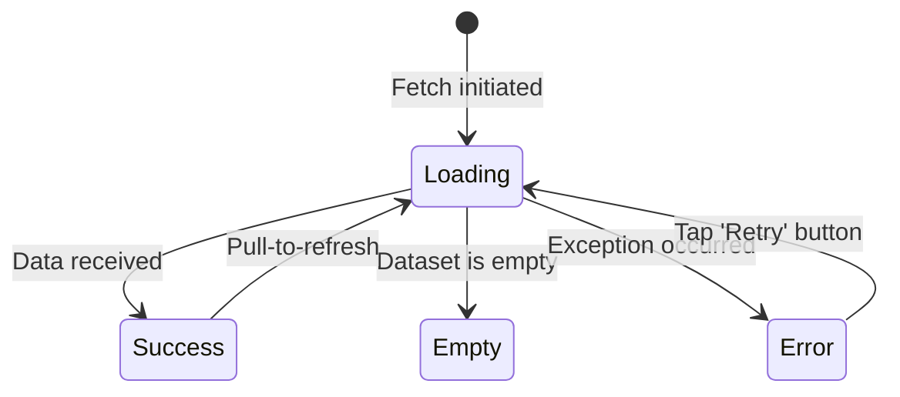

# 📱 Universal Senior Mobile Application Engineering & Product Doctrine

This doctrine establishes the **Complete Senior Lifecycle Framework** for conceiving, architecting, and delivering production-grade mobile applications. It empowers developers and AI agents to operate not merely as code generators, but as **Senior Product Engineers and Principal Mobile Architects**.

---

## 🎭 The 4-Hat Mindset of the Senior Mobile Engineer

Before writing a single line of code, the engineer and AI must cycle through 4 distinct personas:



1. **Product Strategist**: Challenge the need for every screen, eliminate friction, and streamline the core value loop.
2. **Principal UI/UX Designer**: Build cohesive design tokens, enforce thumb-friendly ergonomics, and reject amateur visuals.
3. **Senior Software Architect**: Enforce pure domain models, reactive state, typed failures, granular loading states, and zero-trust security.
4. **Production & QA Engineer**: Ensure zero overflow, homothetic scaling, OS edge-to-edge transparency, native splash, and automated testability.

---

## 1. 🧭 Phase 1: Product Strategy & Page Rationalization

### 🔴 Anti-Patterns (Junior / Sub-standard)
- Creating a separate full-page screen for every tiny interaction or confirmation.
- Adding complex multi-step forms where a single focused sheet would suffice.
- Forcing users through bloated onboarding flows before demonstrating immediate core value.
- Cluttering the main navigation with 6+ bottom bar tabs.

### 🟢 Senior Architectural Doctrine

#### The "Page Justification" Filter:
For every screen requested or planned, ask:
1. **Core Purpose**: What single primary action or decision does the user make on this screen?
2. **Modal vs. Screen**: Can this be an interactive Bottom Sheet, an inline expandable card, or a confirmation snackbar rather than a heavy full route?
3. **Data Efficiency**: Does this screen require network roundtrips that could be prefetched or cached?
4. **Navigation Depth**: Keep critical user journeys under 3 taps from the home dashboard.

#### Core Navigation Architecture:
- **Bottom Navigation**: 3 to 5 tabs maximum (e.g., *Home/Explore, Search/Activity, Main Value Loop, Messages/Notifications, Profile/Settings*).
- **Secondary Flows**: Presented via adaptive Bottom Sheets (`showModalBottomSheet` with `isScrollControlled: true`) or dedicated nested routes.
- **Contextual Actions**: Place high-frequency actions within the primary thumb reach zone (bottom 40% of the viewport).

---

## 2. 🎨 Phase 2: World-Class UI/UX Design System & Visual Integrity

### 🔴 Anti-Patterns (Junior / Sub-standard)
- ❌ **Using Emojis in the UI**: Putting Unicode emojis in buttons, titles, badges, or headers.
- ❌ **Fake AI & Marketing Badges**: Slapping "99% AI Match" or fake compatibility meters not backed by real backend models.
- ❌ **Badge Overload**: Adding 4-5 repetitive tag chips to every list card, cluttering visual hierarchy.
- ❌ **Flat & Lifeless Surfaces**: Using flat, harsh monochrome backgrounds without subtle depth or contrast.
- ❌ **Tiny Touch Targets**: Buttons and icon buttons smaller than 44x44 dp.

### 🟢 Senior Architectural Doctrine

1. **Strict Zero-Emoji Policy**:
   - Use exclusively professional vector iconography (`LucideIcons`, `MaterialSymbols`, or custom SVGs).
   - Emojis cheapen institutional apps and render inconsistently across Android and iOS vendors.

2. **Visual Depth & Semantic Palette**:
   - Utilize refined gradients and surface layers for headers and action cards:
     - `headerGradientStart` -> `headerGradientEnd`
     - `surfaceLight` vs `surfaceDark` with subtle borders (`1px` with `0.08` opacity).
   - Maintain high contrast ratios (>= 4.5:1) for accessibility compliance (WCAG AA).

3. **Sobriety & Hierarchy**:
   - Max 1-2 contextual badges per card (e.g., *Status*, *Category*).
   - Clear typographical rhythm based on an 8pt grid system (8, 16, 24, 32 dp).

4. **Thumb-Zone Mobile Ergonomics**:
   - Primary Call to Action (CTA) must always be sticky at the bottom or reachable with one hand.
   - Minimum interactive touch target: 48x48 dp.

---

## 3. 🌍 Phase 3: Native Bilingual Localization (i18n) from Day 0

### 🔴 Anti-Patterns
- Hardcoding raw user-facing strings (`Text("Connexion")` or `Text("Submit")`) directly in widgets.
- Adding strings in French only or English only without strict dual-language parity.
- Designing fixed-width buttons that overflow when translated (French text is typically 20–30% longer than English).

### 🟢 Senior Architectural Doctrine

1. **Zero Hardcoded Text Rule**:
   - Every string presented to the user (titles, labels, buttons, tooltips, validation errors, dialogs, empty states) MUST be registered in the localization dictionary (`AppLocalizations`).
   - Every translation key must have complete, natural translations in **both French (`fr`) and English (`en`)**.

2. **Access Contract**:
   ```dart
   // Direct typed access
   Text(AppLocalizations.of(context).loginButtonLabel)
   ```

3. **Text Expansion Resilience**:
   - Never set fixed `width` on containers holding translated text.
   - Use `Wrap`, `Flexible`, `Expanded`, or `FittedBox` with `maxLines` and `TextOverflow.ellipsis`.

---

## 4. 📐 Phase 4: Homothetic Responsive Engine & Zero-Overflow Doctrine

### 🔴 Anti-Patterns
- Using hardcoded pixel dimensions (`width: 350`, `height: 80`) that break on small phones (SE 320-375dp) or stretch awkwardly on tablets.
- Unhandled system accessibility text zoom breaking UI buttons and header text.
- Yellow/Black `RenderFlex overflowed by X pixels` stripes when the on-screen keyboard appears.
- Header titles truncated with ellipsis (`...`) on compact devices due to fixed layout widths.

### 🟢 Senior Architectural Doctrine

1. **System Text-Scaling Bounds**:
   - Clamp the OS accessibility text scaler at the root widget to prevent destructive layout blowups:
   ```dart
   MaterialApp(
     builder: (context, child) {
       final mediaQuery = MediaQuery.of(context);
       return MediaQuery(
         data: mediaQuery.copyWith(
           textScaler: mediaQuery.textScaler.clamp(minScaleFactor: 0.85, maxScaleFactor: 1.15),
         ),
         child: child!,
       );
     },
   );
   ```

2. **Screen Ratio Engine (Homothetic Proportional Scaling)**:
   - Provide centralized, high-precision extensions calibrated on the reference canvas (`kRefScreenWidth = 390.0` or `448.0`, `kRefScreenHeight = 844.0` or `998.0`):
   ```dart
   extension ResponsiveExtensions on BuildContext {
     Size get screenSize => MediaQuery.sizeOf(this);
     double get screenWidth => screenSize.width;
     double get screenHeight => screenSize.height;

     bool get isMobile => screenWidth < 768;
     bool get isTablet => screenWidth >= 768 && screenWidth < 1024;
     bool get isDesktop => screenWidth >= 1024;

     // Ratio factors with broad adaptive bounds (0.68x - 1.15x) for compact devices
     double get widthRatio => isMobile ? (screenWidth / kRefScreenWidth).clamp(0.68, 1.15) : 1.0;
     double get heightRatio => isMobile ? (screenHeight / kRefScreenHeight).clamp(0.68, 1.15) : 1.0;

     /// Proportional width
     double rW(double size) => (size * widthRatio).roundToDouble();

     /// Proportional height
     double rH(double size) => (size * heightRatio).roundToDouble();

     /// Proportional square element (avatars, icons, action buttons, bell triggers)
     double rSize(double size) => (size * widthRatio).roundToDouble();

     /// Proportional fluid typography
     double rSp(double fontSize) => (fontSize * widthRatio).roundToDouble();

     /// Proportional padding and spacing
     double rPad(double space) => (space * widthRatio).roundToDouble();
   }
   ```

3. **Dynamic Title & Header Protection (`FittedBox`)**:
   - Wrap dynamic header titles, username greetings, and metrics in `FittedBox(fit: BoxFit.scaleDown)` with `maxLines: 1` to ensure zero truncated ellipses (`...`) on compact phones.

4. **Protected Universal Primitives (`AppButton`)**:
   - Buttons must encapsulate loading spinners, disabled states, and text protection:
   ```dart
   class AppButton extends StatelessWidget {
     final String text;
     final VoidCallback? onPressed;
     final bool isLoading;
     final bool isDisabled;
     
     const AppButton({
       super.key,
       required this.text,
       required this.onPressed,
       this.isLoading = false,
       this.isDisabled = false,
     });

     @override
     Widget build(BuildContext context) {
       final effectiveDisabled = isDisabled || isLoading || onPressed == null;
       return SizedBox(
         height: context.rW(52),
         width: double.infinity,
         child: ElevatedButton(
           onPressed: effectiveDisabled ? null : onPressed,
           child: isLoading
               ? SizedBox(
                   width: context.rW(22),
                   height: context.rW(22),
                   child: const CircularProgressIndicator(strokeWidth: 2.2),
                 )
               : FittedBox(
                   fit: BoxFit.scaleDown,
                   child: Text(text, maxLines: 1),
                 ),
         ),
       );
     }
   }
   ```

5. **Keyboard Avoidance & Scroll Hygiene**:
   - Interactive forms and input screens must always be wrapped in:
   ```dart
   SingleChildScrollView(
     keyboardDismissBehavior: ScrollViewKeyboardDismissBehavior.onDrag,
     padding: EdgeInsets.only(
       left: context.rPad(16),
       right: context.rPad(16),
       bottom: MediaQuery.viewInsetsOf(context).bottom + context.rPad(24),
     ),
     child: ...
   )
   ```

6. **Large Screen & Tablet Constraints**:
   - Cap maximum content width to `600dp` centered on tablet viewports:
   ```dart
   Center(
     child: ConstrainedBox(
       constraints: const BoxConstraints(maxWidth: 600),
       child: child,
     ),
   )
   ```

---

## 5. 🔘 Phase 5: Granular Button & Action Loading Isolation

### 🔴 Anti-Patterns (Amateur / "Violent" UI Loading)
- ❌ **Monolithic `isLoading` Flag**: Using a single global boolean `isLoading` on a screen containing multiple action buttons (e.g. "Continue with Google", "Continue with Apple", "Sign In with Email", or "Save Draft" vs "Publish").
- ❌ **Mass Button Spinning**: When the user taps one button, *every* button on the screen abruptly turns into a spinner simultaneously. This looks chaotic, amateurish, and confuses the user about which process is running.

### 🟢 Senior Architectural Doctrine

1. **Scoped Action Identifiers / Enums**:
   - Model asynchronous actions as typed enums or distinct identifiers:
   ```dart
   enum AuthAction { none, google, apple, emailPassword }

   class AuthState {
     final AuthAction loadingAction;
     final String? errorMessage;
     
     bool get isAnyLoading => loadingAction != AuthAction.none;
     bool isLoading(AuthAction action) => loadingAction == action;
   }
   ```

2. **Targeted Loader vs. Graceful Disabling**:
   - **Only the triggered button shows the spinner**: `isLoading: state.isLoading(AuthAction.google)`.
   - **Sibling buttons are safely disabled WITHOUT showing spinners**: `isDisabled: state.isAnyLoading`.
   ```dart
   // Google Button
   AppButton(
     text: localizations.continueWithGoogle,
     isLoading: state.isLoading(AuthAction.google),
     isDisabled: state.isAnyLoading,
     onPressed: () => ref.read(authNotifierProvider.notifier).signInWithGoogle(),
   ),
   const SizedBox(height: 12),
   // Apple Button
   AppButton(
     text: localizations.continueWithApple,
     isLoading: state.isLoading(AuthAction.apple),
     isDisabled: state.isAnyLoading,
     onPressed: () => ref.read(authNotifierProvider.notifier).signInWithApple(),
   ),
   ```

3. **Per-Item Loading in Lists & Collections**:
   - In lists with interactive action triggers (e.g., "Follow", "Apply", "Delete", "Bookmark"), track loading state per item ID (`final Set<String> loadingItemIds;`).
   - Only the row matching the tapped ID displays a spinner; the rest of the list remains clear and stable.

---

## 6. 🏛️ Phase 6: Domain-Driven Clean Architecture & Inversion of Control

Group code strictly by **Business Domain Features**, never solely by technical type.

```
lib/
├── core/
│   ├── config/              # Environment config & compile-time variables
│   ├── di/                  # Dependency Injection container & root providers
│   ├── errors/              # Universal Failure & Exception models
│   ├── localization/        # AppLocalizations (FR/EN)
│   ├── network/             # HTTP client, interceptors, retry policies
│   ├── theme/               # Semantic design tokens, typography (AppTypography)
│   ├── utils/               # Structured AppLogger, formatters, extensions
│   └── widgets/             # Core reusable UI primitives (AppButton, AppTextField, Shimmer)
└── features/
    └── [feature_name]/
        ├── data/
        │   ├── datasources/ # Remote API clients, local SQLite/Hive/SecureStorage
        │   ├── dto/         # Data Transfer Objects (serialization & deserialization)
        │   └── repositories/# Concrete repository implementations
        ├── domain/
        │   ├── entities/    # Pure Dart business objects (immutable, ZERO serialization logic)
        │   ├── repositories/# Abstract repository contracts (interface I[Feature]Repository)
        │   └── usecases/    # Single-responsibility business use cases
        └── presentation/
            ├── providers/   # State controllers (AsyncNotifiers, Blocs, Cubits)
            ├── screens/     # Top-level screen widgets (Pure UI renderers)
            └── widgets/     # Feature-specific sub-components
```

### 💎 The Domain Purity Rule:
- The `domain/` layer must be **100% pure Dart**. It MUST NEVER import `package:flutter`, `dart:io`, or database drivers.

### ⚡ Reactive Inversion of Control ($UI = f(State)$):
- Repositories and datasources are injected via dependency injection (Riverpod Providers or GetIt).
- Widgets never perform asynchronous fetching inside `initState()` with `setState()`.

### 🔒 Zero-Trust Client Security:
- **Never store sensitive secrets in the app binary**: Admin keys, master database passwords, and service role keys must only live on the server or Edge functions.
- Inject public publishable variables at compile time:
  `flutter build apk --dart-define=API_BASE_URL=https://api.domain.com --dart-define=PUBLIC_KEY=pk_live_...`

---

## 7. 🛡️ Phase 7: Exhaustive 4-State UI Contract & Error Architecture

Every data-driven screen MUST implement the **Canonical 4-State Contract**:



### 1. Universal Failure Hierarchy:
```dart
sealed class AppFailure {
  final String userMessage;
  const AppFailure(this.userMessage);
}

class NetworkFailure extends AppFailure {
  const NetworkFailure([super.userMessage = 'Vérifiez votre connexion internet.']);
}

class NotFoundFailure extends AppFailure {
  const NotFoundFailure([super.userMessage = 'La ressource demandée est introuvable.']);
}

class ServerFailure extends AppFailure {
  const ServerFailure([super.userMessage = 'Un problème technique est survenu.']);
}
```

### 2. The 4 Mandatory Visual States:
1. **Loading**: Content-shaped **Skeleton/Shimmer** loader matching the exact shape of the incoming content (never a solitary raw center spinner).
2. **Success / Data**: The rendered view with native **Pull-to-Refresh** (`RefreshIndicator`).
3. **Empty**: Contextual vector illustration + clear localized explanation + primary **Call to Action** button.
4. **Error**: Clear human-friendly explanation + prominent **"Réessayer / Retry"** action button.

---

## 8. 🚀 Phase 8: OS-Native Polish, Routing & Production Diagnostics

1. **True Edge-to-Edge System Bars**:
   - Transparent navigation and status bars with adaptive icon brightness:
   ```dart
   SystemChrome.setEnabledSystemUIMode(SystemUiMode.edgeToEdge);
   SystemChrome.setSystemUIOverlayStyle(
     const SystemUiOverlayStyle(
       statusBarColor: Colors.transparent,
       statusBarIconBrightness: Brightness.dark,
       systemNavigationBarColor: Colors.transparent,
       systemNavigationBarIconBrightness: Brightness.dark,
     ),
   );
   ```

2. **Native OS Splash Screen Protocol**:
   - Splash screens belong to the native OS window manager (`flutter_native_splash` configuring Android 12+ Splash API and iOS `LaunchScreen.storyboard`).
   - Zero artificial `Future.delayed(Duration(seconds: 3))` timers in Flutter code.

3. **Declarative Routing & Deep Linking**:
   - Centralized declarative router (`GoRouter`) with authentication guards (`redirect` callback) and parameterized deep link routes (`/items/:id`).

4. **Structured Logging (`AppLogger`)**:
   - Strictly prohibit raw `print()` statements.
   - Use centralized leveled logging:
     - `AppLogger.d(msg)`: Verbose debug logs (stripped in release).
     - `AppLogger.i(msg)`: High-level lifecycle & navigation events.
     - `AppLogger.w(msg)`: Recoverable warnings.
     - `AppLogger.e(msg, [err, stack])`: Critical errors logged with stack traces.

5. **Resource Lifecycle Safety**:
   - Every `AnimationController`, `TextEditingController`, `StreamSubscription`, and `Timer` must be explicitly cancelled and disposed in `dispose()` or Riverpod `ref.onDispose()`.

---

## 9. 🧪 Phase 9: Comprehensive Automated Testing Matrix

Senior code is verified across three testing tiers:
1. **Unit Tests**: Domain entities, use cases, business validation logic, DTO mapping.
2. **State Controller Tests**: Verifying state transitions (Loading -> Success, Loading -> Error) using isolated DI containers.
3. **Widget & Interaction Tests**: Verifying UI contracts, tap triggers, isolated button loadings, empty state renders, and error retry flows using mocks (`mocktail`).

---

## 🤖 Step-by-Step AI Execution Protocol

When prompted to create or evolve a mobile feature, the AI MUST follow this exact sequence:

1. **Step 1 (Product & UX Rationalization)**:
   - Challenge screen count. Propose the minimal, most intuitive flow. Confirm whether modal sheets or inline cards are better than full screens.
2. **Step 2 (Design System & i18n Keys)**:
   - Define localized string keys (FR & EN). Confirm typography tokens and vector iconography.
3. **Step 3 (Domain & Contracts)**:
   - Write pure Dart entities and abstract repository contracts.
4. **Step 4 (Data, State & Granular Loading)**:
   - Implement data sources, DTOs, and reactive state notifiers with typed failures and isolated action loading identifiers (`loadingAction`).
5. **Step 5 (Presentation with 4-State UI & Homothetic Responsiveness)**:
   - Build UI using `AppButton`, `context.rW()`, `context.rH()`, `context.rSize()`, `context.rSp()`, `FittedBox` title safety, keyboard scroll hygiene, and shimmer loading.
6. **Step 6 (OS Polish & Verification)**:
   - Verify Edge-to-Edge compliance, zero hardcoded strings, zero emojis, zero shared loading flashes, and run automated tests.
